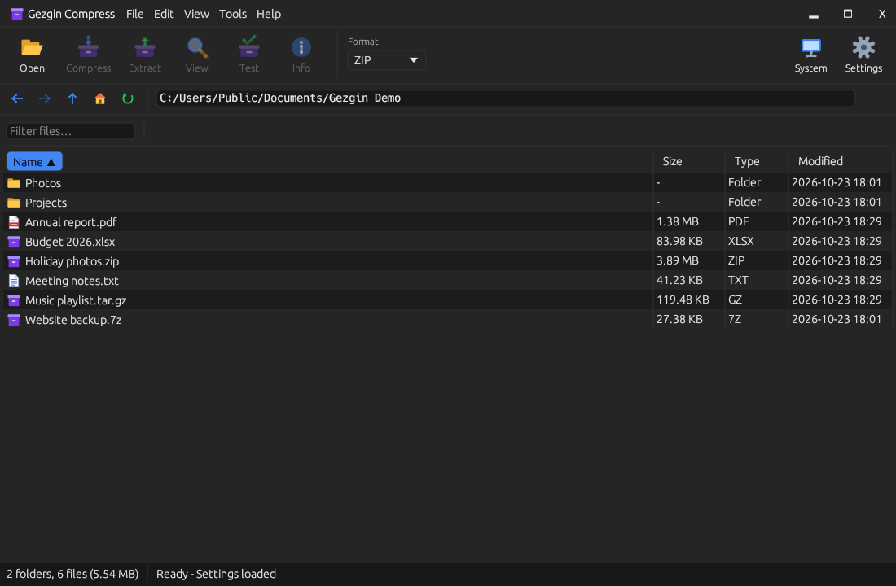
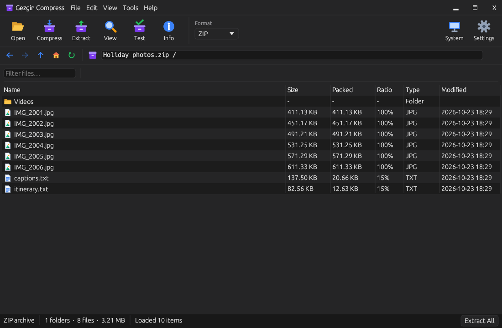
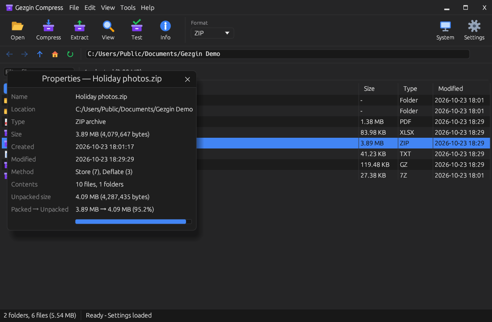
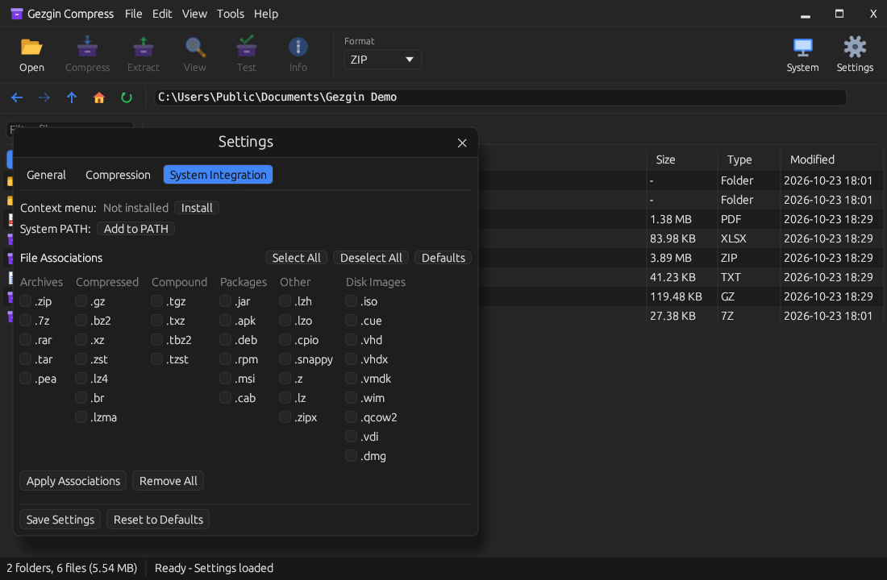

# Gezgin Compress

A fast, simple archive manager for Windows. Open, create, test and convert
archives in **101 formats** — from ZIP, 7z and RAR to disk images and file
systems — in a clean window or from the command line.



> **Version 1.0.1.** Found a problem? Please
> [open an issue](../../issues).

## Download

Get the latest version from the **[Releases](../../releases)** page:

| File | What it is |
|---|---|
| `GezginCompress-1.0.1-Setup.exe` | Installer: Start menu and desktop shortcuts, Explorer right-click menu, optional file associations, uninstaller |
| `SHA256SUMS.txt` | Checksum to verify the download |

Requirements: Windows 10 or 11, 64-bit.

The program is not code-signed yet, so Windows SmartScreen may say
"Windows protected your PC" the first time. Choose **More info → Run
anyway**.

## Features

- **Browse archives like folders.** Open an archive, move through its
  folders, tick the files you want and extract only those.
- **Create archives** in one dialog: name, location, format, level, password
  and split size. Many files and folders go into a single archive.
- **Extract** to any folder, optionally into a subfolder named after the
  archive. You are asked before anything is overwritten.
- **Test** an archive: every entry is decoded, nothing is written, and the
  result tells you exactly what is damaged.
- **Properties** at a glance: files and folders inside, packed and unpacked
  size, compression ratio and the methods used (Deflate, LZMA2, …).
- **Convert** between formats, **compare** two archives, and compute
  **checksums** (CRC32, MD5, SHA-256).
- **Passwords:** AES-256 for ZIP and PEA archives; encrypted ZIP, 7z and RAR
  archives open with their password.
- **Split archives:** write volumes of the size you choose; open `.001`
  sets.
- **Explorer integration:** "Compress with" and "Extract with" on the
  right-click menu; opening archives with a double-click is an option in
  the setup.
- **Safe by default:** files that try to escape the target folder, Windows
  device names and decompression bombs are refused.
- **12 languages:** English, Turkish, German, French, Spanish, Portuguese
  (Brazil), Italian, Polish, Russian, Chinese (Simplified), Japanese and
  Korean — follows your Windows language, or pick one in Settings.
- Dark, light or system theme.





## Formats

26 formats can be created; all 101 can be opened.

| Group | Formats |
|---|---|
| Archives | ZIP, 7z, TAR, PEA, RAR (open), CAB (open), LZH (open), ZIPX (open), CPIO, AR |
| Compressors | gzip, bzip2, xz, zstd, lzip, Brotli, LZMA, Snappy, LZFSE, zlib, Zopfli and more; LZ4, LZO and Unix compress (.Z) open only |
| Compound | .tar.gz, .tar.xz, .tar.bz2, .tar.zst, .tar.lzma; .tar.lz4 and .tar.Z open only |
| Packages | JAR, APK, DEB, RPM, MSI, XAR/PKG, Pack200, self-extracting EXE |
| Disk images | ISO, BIN/CUE, UDF, VHD, VHDX, VMDK, VDI, QCOW2, DMG, WIM |
| File systems | NTFS, FAT, exFAT, ext2/3/4, btrfs, XFS, EROFS, APFS, HFS+, UFS, ZFS, Minix, romfs, SquashFS, CramFS, JFFS2 |
| Retro and game | ARJ, ARC, ACE, Zoo, HA, UC2, LZX, StuffIt, Amiga ADF/DMS, C64 D64/T64, Atari ATR, Switch NSP/NSZ/XCI, Unreal PAK, VPK and more |
| Backup | DAR |

Renamed containers open too: `.cbz`, `.epub`, `.docx`, `.xlsx`, `.odt`,
`.whl`, `.appx`… as ZIP; `.cbr` as RAR; `.cbt` as TAR.



## Command line

The same program works from a terminal when given a command:

```text
gezgin-compress compress <files…> -f zip -o out.zip
gezgin-compress extract <archives…> -o <folder>
gezgin-compress list <archive>
gezgin-compress test <archives…>         # exits 1 if any archive is damaged
gezgin-compress install --context-menu   # add the Explorer entries
gezgin-compress uninstall --context-menu
```

`gezgin-compress <command> --help` lists every option.

## Uninstalling

Installed with the setup: **Settings → Apps → Gezgin Compress → Uninstall**.
The Explorer menu entries and file associations are removed with it.
Settings are kept in `%APPDATA%\Gezgin\Gezgin Compress`.

## License

Gezgin Compress is **freeware**: free for personal and commercial use. The
source code is not published. You may share the unmodified installer free of
charge. See the [End User License Agreement](LICENSE.txt) for the full terms.

It is built on open-source libraries, listed with their licenses in
[THIRD_PARTY_NOTICES.md](THIRD_PARTY_NOTICES.md).

© 2026 Volkan Uzuntepe. All rights reserved.
